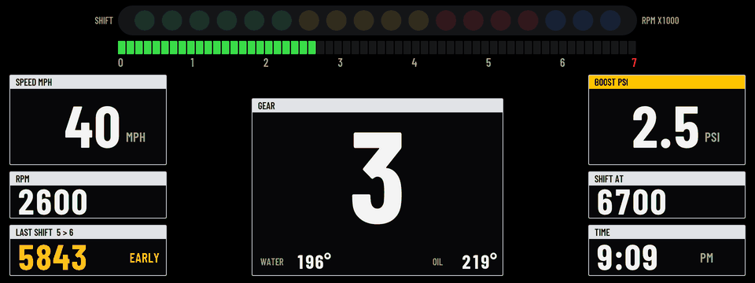
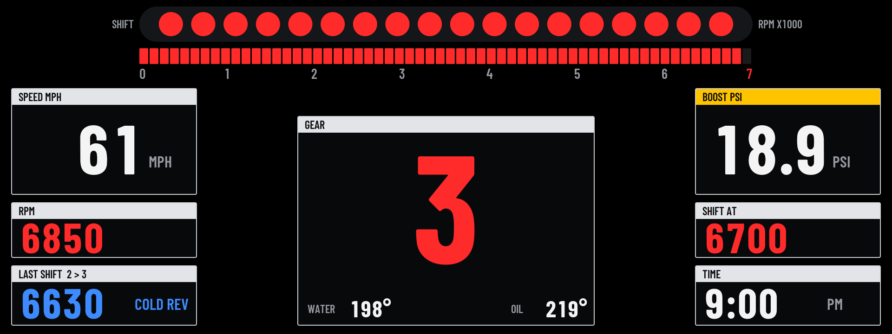
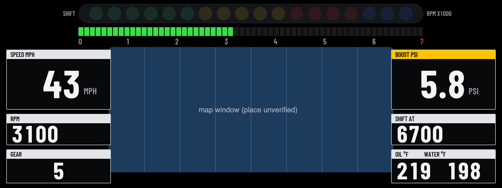

# Cluster Themes

Redraws the whole instrument cluster with your own themes. Open **Cluster Themes** from the apps menu on the center screen and pick the theme there.

## Themes

**GT3:** a race dash.

- **Top:** 18 round shift lights (green, yellow, red, then blue) that fill over the last 2000 rpm before your shift point, and a segmented rev bar.
- **Left:** speed, rpm, and your last shift with its grade.
- **Middle:** the gear, with water and oil temperatures.
- **Right:** boost, your shift point, and the clock.
- **At the shift point,** the lights, the rev bar, the rpm and the gear all go red.

More themes are on the way.

| At the shift point | With room for the map |
| --- | --- |
|  |  |

## Settings

- **Theme**
- **Leave room for the map:** cuts a window out of the dash so the map can show through, and moves the gear and temperatures to the sides.
- **Units:** mph, °F, psi or km/h, °C, bar
- **Clock:** 12-hour or 24-hour
- **Redline**
- **Shift point before redline:** how far below the redline the shift lights peak (300 rpm by default)
- **Cold-engine rev guard:** until the oil reaches 80°C, the shift point starts at 4500 rpm and climbs as the oil warms up
- **Show boost**
- **Demo data:** fake data for trying it out parked

**Shift grades:** every upshift is graded on its peak rpm. EARLY means more than 250 rpm under the shift point, LATE more than 200 over it, COLD REV the same while the cold guard is on, LIMITER within 60 rpm of the redline, and anything in between is SPOT ON.

## Requirements

[cluster-render](https://github.com/robertnisipeanu/idrive-apps), installed from the `robertnisipeanu/idrive-apps` Store source.

## Status

Version 0.1.0, in its first car test. Still to be checked on a car:

- **Whether BMW's warning lights still show over the dash.** The GT3 theme is solid black and covers whatever is under it. Test it parked: start the car with a seat belt off and look for the warning.
- **Where the map window really sits** on the cluster. The cut-out's position is a guess.
- How the colours and edges look on the real screen.
