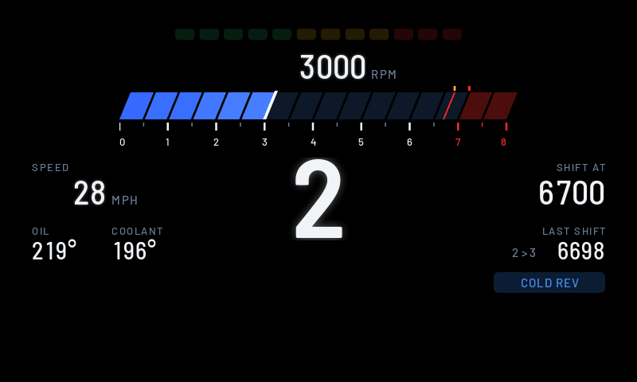
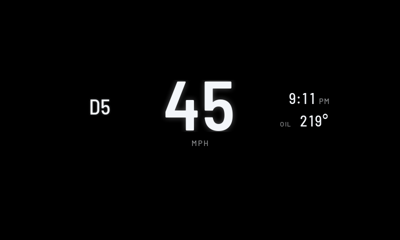
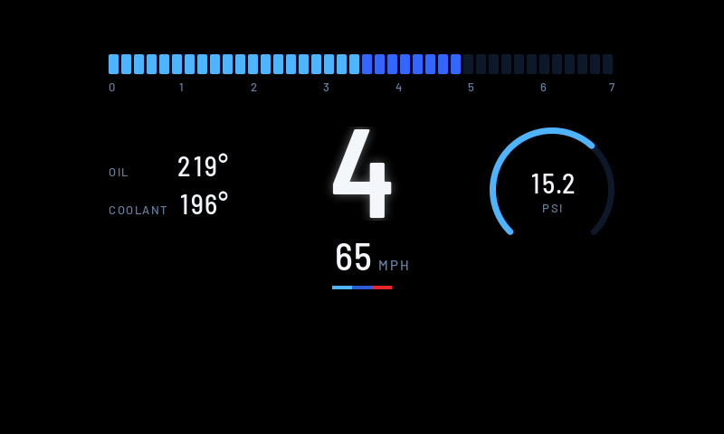
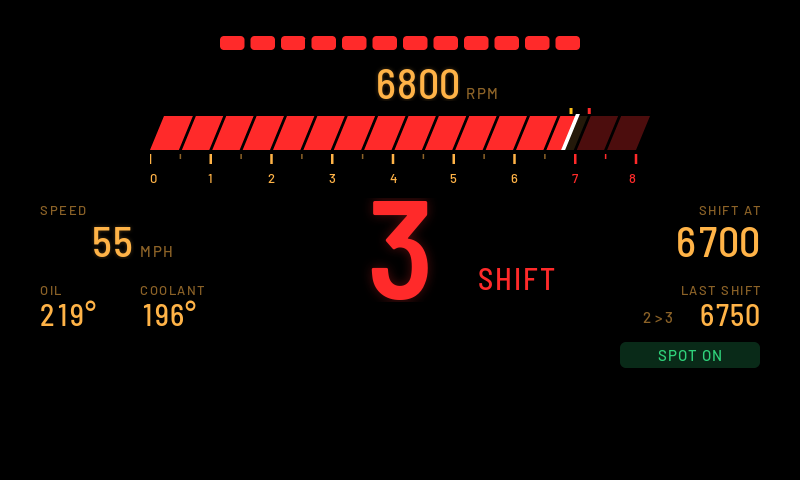

# HUD Widgets

Your own widgets on the windshield HUD: speed, gear, a shift bar, boost, oil and coolant temperatures, and a clock. Open **HUD Widgets** from the apps menu on the center screen and pick the layout, theme, units and widgets there.

## Layouts

| Daily | Sport | Redline |
| --- | --- | --- |
|  |  |  |

- **Daily:** speed is the hero, with the gear, clock and oil.
- **Sport:** a segmented shift bar, a big gear, speed, a boost gauge, oil and coolant.
- **Redline:** a slanted G20-style rev bar with 12 shift lights, a big gear, and your shift point.
  - **Shift lights:** they fill over the last 2000 rpm before the shift point. At the shift point, everything goes red and SHIFT shows.
  - **Shift grades:** every upshift is graded on its peak rpm. EARLY means more than 250 under the shift point, LATE more than 200 over it, COLD REV the same while the cold guard is on, LIMITER within 60 rpm of the redline, and anything in between is SPOT ON.
  - **Cold-engine guard:** until the oil reaches 80°C, the shift point starts at 4500 rpm and climbs as the oil warms up.

## Themes

Classic, M and Night, plus Auto, which switches to Night at sunset. You choose which theme Auto uses in daytime.

## Settings

Layout, theme, daytime theme for Auto, units (mph, °F, psi or km/h, °C, bar), 12- or 24-hour clock, redline, shift point before redline, cold-engine rev guard, which readouts show (clock, oil, coolant, boost), and demo data. Changes show on the HUD right away. The HUD keeps running after you leave the page.

The page's first row tells you what the HUD is doing, or why it's off.

## Requirements

[cluster-render](https://github.com/robertnisipeanu/idrive-apps), installed from the `robertnisipeanu/idrive-apps` Store source. Without it, the status row reads "HUD off: cluster-render is not installed or not running".

## Status

Version 0.3.1. Not yet confirmed on a car. Still to be checked on a car:

- whether the car sends the boost reading the app uses;
- how the colours and edges look on the real glass, especially the M blues in sunlight;
- whether the head unit's clock is in local time.
